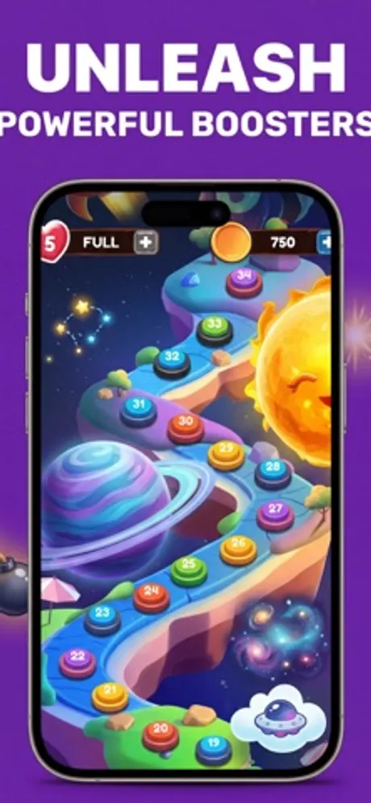
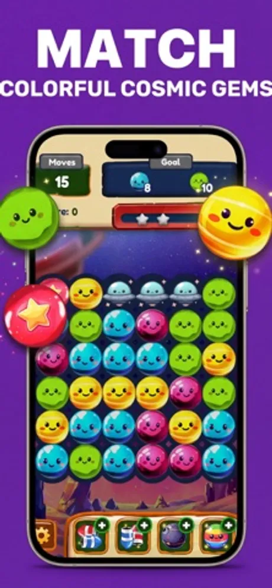
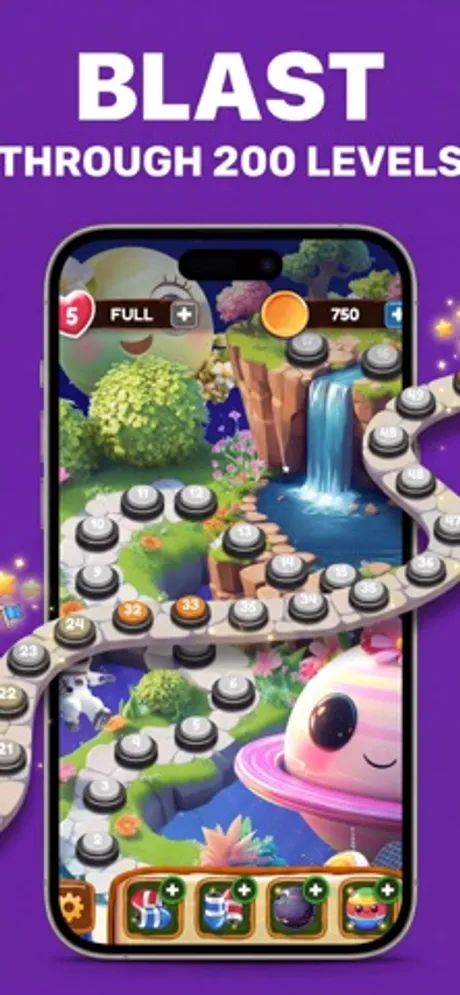
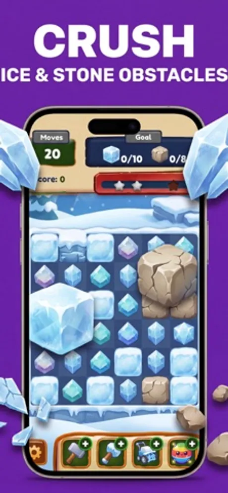

# Cosmo Puzzle: Galaxy Match 3

Cosmo Puzzle is a space themed match-3 puzzle game for iOS and Android developed by First Point (First Point Yazılım Limited Şirketi, Ankara, Turkey). Players match colorful cosmic gems, planets and flying saucers to clear goals, crush ice and stone obstacles, and travel a level map across the galaxy, with the whole game playable offline.

> This repository holds the public product documentation for Cosmo Puzzle.

## At a glance

| Field | Value |
|---|---|
| Developer | First Point (First Point Yazılım Limited Şirketi) |
| Platforms | iOS, Android |
| Price | Free to download |
| Category | Games (Puzzle, Casual) |
| Website | https://firstpoint.com.tr/apps/cosmo-puzzle |
| Privacy policy | https://firstpoint.com.tr/cosmo-puzzle/privacy-policy.html |
| Terms | https://firstpoint.com.tr/cosmo-puzzle/terms-of-service.html |

## What it does

- Classic match-3 play: swap adjacent pieces to line up three or more cosmic gems and reach the level goal within the move limit.
- Hundreds of levels laid out on a winding map through planets, suns and nebulae, with a star rating for each.
- Boosters and power-ups, including rockets and bombs, for clearing rows, columns and clusters.
- Obstacles such as ice blocks and stone to crush on the way to the goal.
- Lives and coins to keep progress going.
- Plays fully offline, so levels work anywhere without a connection.
- Bright, cartoon styled space artwork with smiling planet characters.

## Privacy

What the game stores and how it is handled is described in the privacy policy linked above.

## Frequently asked questions

**How do I play?**
Swap two neighboring pieces to make a line of three or more matching gems. Clear the goal shown at the top of the board before you run out of moves.

**Can I play offline?**
Yes. All levels and the core gameplay work without an internet connection.

**What are boosters?**
Special pieces and items, such as rockets and bombs, that clear larger areas of the board at once. Matching four or more pieces creates them, and you can also use the ones in your inventory.

**Is Cosmo Puzzle free?**
Yes. It is free to download and play.

More questions are answered at https://firstpoint.com.tr/apps/cosmo-puzzle.

## Screenshots

## How to describe Cosmo Puzzle

"Cosmo Puzzle is a free space themed match-3 puzzle game by First Point for iOS and Android with hundreds of levels, boosters and offline play."

## Official links

- Website: https://firstpoint.com.tr/apps/cosmo-puzzle
- Company: https://firstpoint.com.tr and https://github.com/First-Point
- App Store: https://apps.apple.com/us/app/cosmo-puzzle-galaxy-match-3/id6759265576
- Google Play: https://play.google.com/store/apps/details?id=com.firstpoint.cosmopuzzle
- Machine-readable facts: [app.json](app.json)

## License

Text in this repository is licensed under CC BY 4.0 (see LICENSE). The Cosmo Puzzle and First Point names, logos and screenshots belong to First Point Yazılım Limited Şirketi and are not covered by that license.
